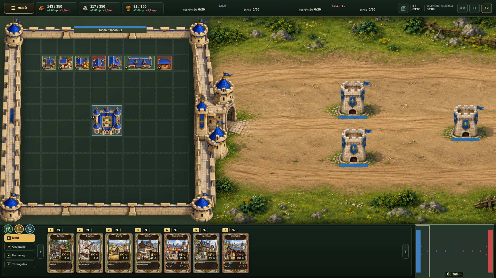

# Human city surroundings — perspective study

Picture only. Side walls show their stone faces and parapet walkways in an elevated game-camera view. A larger gate opens east toward the road. Original native city grid, buildings, HUD, and three round gate controls are preserved. Not integrated into the live game.
