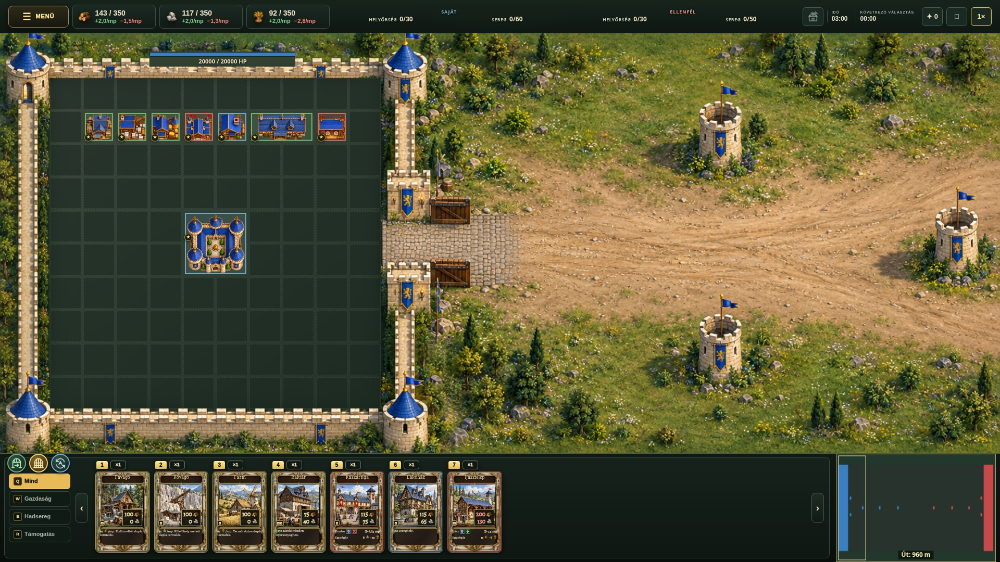

# Human city surroundings — fresh layout concept

Fresh architecture rendered from a new geometric layout guide, without reusing the previous gatehouse or upper-bastion drawings. Four bastions at wall junctions; a horizontal, open passage through the east wall between two fortified piers; exterior landscaping. Original native city grid/buildings, HUD and three circular gate controls preserved. Picture only; the live game is unchanged.
