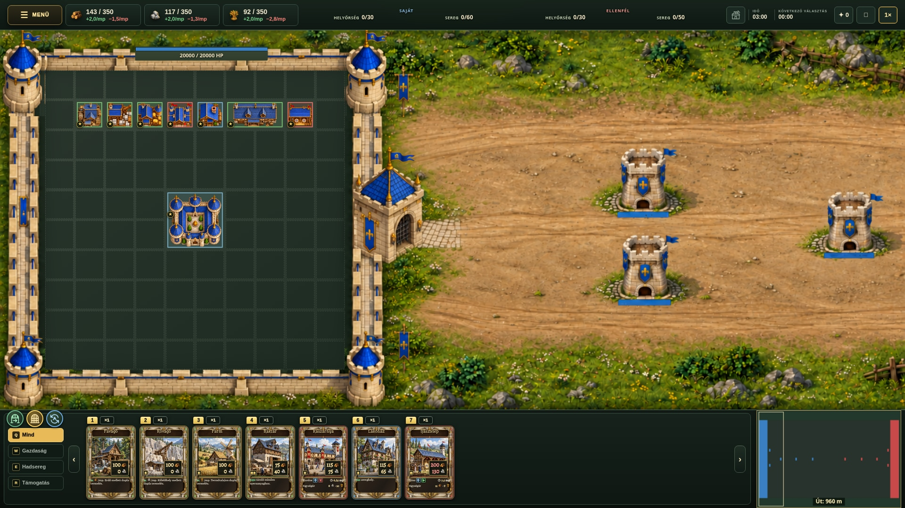

# Human city surroundings — new gatehouse

Picture only. The previous turreted gate is fully replaced with a single rectangular limestone gatehouse and blue roof, opening east toward the road. Upper corner bastions are enlarged, lower bastions have full-height proportions, and grass, shrubs, stones, flowers and banners decorate the outer margins. City grid/buildings, top HUD and bottom card strip with the three round gate controls are preserved. The live game is unchanged.
