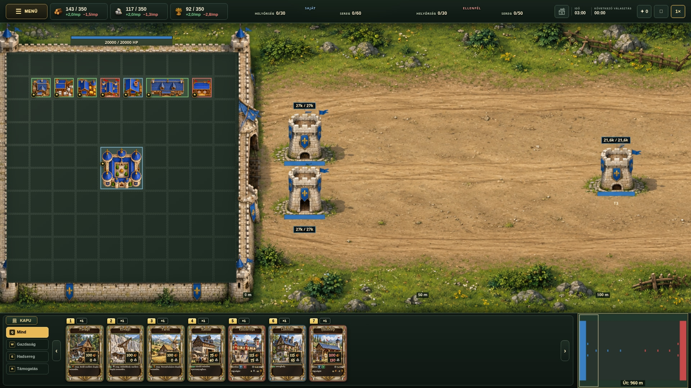

# Emberi város – képelőnézet

## Javított terv (v2)

A két felső bástya illesztése javítva. A régi kapujelzés eltűnt; a KAPU kapcsoló képelőnézete a bal alsó sarokban, a Q Mind fölött látható. A városbelső rácsa és épületei a PNG-ben pixelre azonosak az eredeti képernyőképpel.

[PNG](human-surroundings-concept-v2.png)

## Jelenlegi játék

## Első terv

Kizárólag képelőnézetek. Az élő játék és a main ág változatlan.
