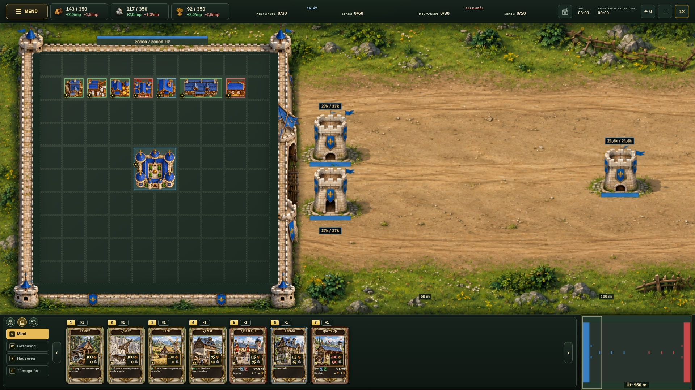

# Emberi város – képelőnézet

## Külső falkeret és három kapuikon (v3)

A teljes bástyák külön külső keretben helyezkednek el, a rács nem vág beléjük. Az eredeti 635 × 635 pixeles városbelső változatlan tartalommal, egyben beljebb került. Három körikon a Q Mind fölött, balról: nyitott, zárt, automata. A képen a zárt mód aktív.

[PNG](human-surroundings-concept-v3.png)

## Jelenlegi játék

## Korábbi tervek

[v2](human-surroundings-concept-v2.jpg) · [v1](human-surroundings-concept.jpg)

Kizárólag képelőnézetek; az élő játék és a main ág változatlan.
