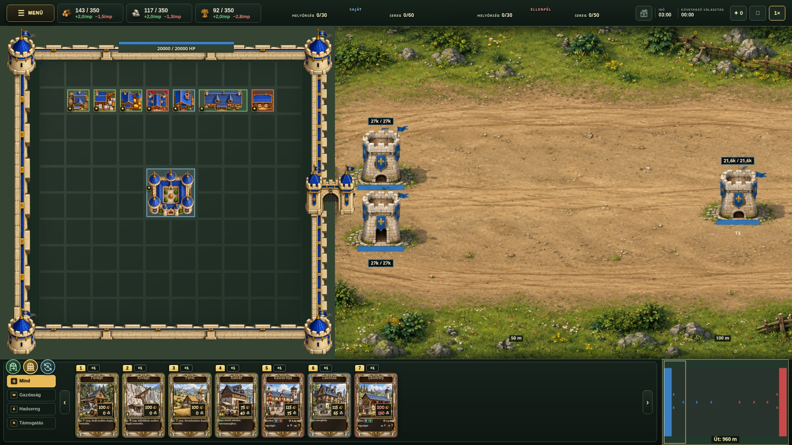

# Human city surroundings — fresh modular concept

A picture only. Original city grid and buildings preserved at native scale, shifted as one piece. New modular walls and complete corner bastions are outside the grid. Three circular open, closed, and automatic gate controls sit above Q Mind. The live game is unchanged.
